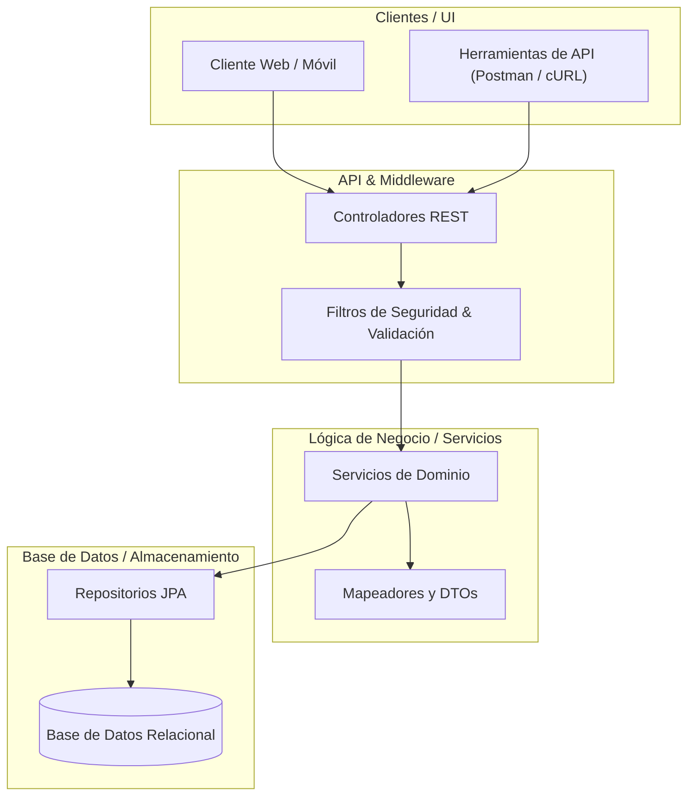

<div align="center">

# Proyecto Integrador B1 2026-2 G2

<!-- Badges Oficiales -->
<p>
  
  
  
  
  
</p>

*Plataforma de software empresarial robusta basada en una arquitectura modular orientada a dominios y construida bajo estándares estrictos de ingeniería de software.*

</div>

---

## 📋 Resumen Ejecutivo
**Proyecto Integrador B1** es una solución backend de alta disponibilidad diseñada para resolver desafíos complejos de procesamiento de datos y gestión transaccional. Este repositorio implementa principios sólidos de diseño de software (SOLID, Domain-Driven Design), asegurando un acoplamiento bajo y una alta cohesión para facilitar la mantenibilidad, escalabilidad horizontal y la integración continua en entornos de producción.

## ✨ Características Principales
- 🏗️ **Arquitectura Modular:** Componentes desacoplados que permiten un mantenimiento y evolución independientes de los dominios de negocio.
- ⚡ **Alto Rendimiento:** Construido sobre el ecosistema de Spring Boot para optimizar el uso de recursos y tiempos de respuesta.
- 🐳 **Contenedorización Nativa:** Soporte completo para Docker, garantizando paridad entre los entornos de desarrollo, pruebas y producción.
- 🛡️ **Seguridad y Resistencia:** Mecanismos robustos de manejo de excepciones, validación de entradas y control de acceso.
- 📊 **Observabilidad Preparada:** Endpoints de monitoreo y métricas integrados para un seguimiento proactivo de la salud del sistema.

## 🏛️ Arquitectura del Sistema
El siguiente diagrama muestra el flujo de alto nivel y la separación de capas adoptada en el proyecto:



## 🧰 Stack Tecnológico
| Categoría | Tecnología | Versión / Uso | Justificación |
| :--- | :--- | :--- | :--- |
| **Lenguaje** | Java | 17+ | Estándar de la industria para sistemas empresariales robustos y tipados estáticamente. |
| **Framework** | Spring Boot | 3.x | Acelera el desarrollo mediante autoconfiguración y un ecosistema maduro. |
| **Construcción** | Apache Maven | 3.8+ (Wrapper incl.) | Gestión de dependencias predecible y ciclo de vida de compilación estandarizado. |
| **Contenedorización** | Docker | Engine 20+ | Aislamiento de entornos y despliegue agnóstico de infraestructura. |

## 📂 Estructura de Directorios
```text
.
├── .mvn/                  # Configuración del Maven Wrapper
├── src/                   # Código fuente principal y pruebas
├── .gemini/               # Configuraciones de asistencia de desarrollo
├── Dockerfile             # Definición de la imagen contenedora de la aplicación
├── LICENSE.md             # Términos de licencia del proyecto
├── pom.xml                # Declaración de dependencias y plugins de Maven
├── mvnw                   # Maven Wrapper para sistemas Unix/Linux
└── mvnw.cmd               # Maven Wrapper para sistemas Windows
```

## ⚙️ Requisitos Previos
Asegúrate de contar con las siguientes herramientas instaladas en tu entorno local:
- **Java Development Kit (JDK):** Versión 17 o superior.
- **Apache Maven:** Versión 3.8 o superior (opcional, se incluye Maven Wrapper).
- **Docker:** Versión 20.x o superior (opcional para ejecución en contenedores).

## 🚀 Guía de Instalación y Puesta en Marcha

1. **Clonar el repositorio:**
   ```bash
   git clone https://github.com/jfinfotest/proyecto-integrador-b1-2026-2-g2.git
   cd proyecto-integrador-b1-2026-2-g2
   ```

2. **Compilar el proyecto usando Maven Wrapper:**
   ```bash
   ./mvnw clean install
   ```

3. **Ejecutar la aplicación:**
   ```bash
   ./mvnw spring-boot:run
   ```

4. **Ejecución mediante Docker (Opcional):**
   ```bash
   docker build -t proyecto-integrador .
   docker run -p 8080:8080 proyecto-integrador
   ```

## 🔐 Variables de Entorno
Actualmente el proyecto utiliza valores por defecto optimizados para desarrollo local. En caso de requerir configuraciones avanzadas, configure las siguientes propiedades en su archivo `application.yml` o mediante variables de entorno del sistema operativo:

* `SERVER_PORT`: Puerto en el que se ejecuta la aplicación (Por defecto: `8080`).
* `SPRING_PROFILES_ACTIVE`: Perfil de ejecución activo (`dev`, `prod`, `test`).

## 📜 Scripts Disponibles
| Comando | Descripción |
| :--- | :--- |
| `./mvnw clean` | Limpia los archivos compilados previamente en el directorio `target`. |
| `./mvnw compile` | Compila el código fuente del proyecto. |
| `./mvnw test` | Ejecuta la suite de pruebas unitarias e integración. |
| `./mvnw package` | Empaqueta la aplicación en un archivo ejecutable JAR. |
| `./mvnw spring-boot:run` | Inicia el servidor de desarrollo local con Spring Boot. |

## 🌐 Endpoints Principales / Rutas de API
*La documentación interactiva de la API (Swagger/OpenAPI) estará disponible una vez iniciada la aplicación en el puerto configurado.*

| Método HTTP | Ruta | Descripción |
| :--- | :--- | :--- |
| `GET` | `/actuator/health` | Verifica el estado de salud y disponibilidad del servicio. |
| `GET` | `/api/v1/...` | *Endpoints principales del dominio de negocio (Pendiente de implementación específica).* |

## 🧪 Pruebas y Calidad de Código
Para garantizar la estabilidad del sistema, ejecute la suite de pruebas automatizadas mediante Maven:
```bash
./mvnw test
```
Para generar un reporte completo de cobertura y análisis estático:
```bash
./mvnw verify
```

## 🔍 Solución de Problemas Comunes (FAQ)
- **Error: `JAVA_HOME is not defined`**: Asegúrate de tener configurada la variable de entorno `JAVA_HOME` apuntando a una instalación válida de JDK 17 o superior.
- **Conflicto de Puertos**: Si el puerto `8080` se encuentra ocupado, puedes modificar el puerto de ejecución agregando `--server.port=9090` al comando de ejecución.

## 🗺️ Hoja de Ruta (Roadmap)
- [ ] Implementación de persistencia avanzada con base de datos relacional.
- [ ] Integración de Spring Security con autenticación basada en JWT.
- [ ] Configuración de pipelines CI/CD mediante GitHub Actions.
- [ ] Ampliación de la cobertura de pruebas unitarias al 85%+.

## 🤝 Contribución
¡Las contribuciones son bienvenidas! Por favor, lee nuestro [CONTRIBUTING.md](CONTRIBUTING.md) (próximamente disponible) para conocer el flujo de trabajo, las guías de estilo de código y el proceso para enviar pull requests.

## 📄 Licencia
Este proyecto está distribuido bajo los términos de la [Licencia MIT](LICENSE.md).